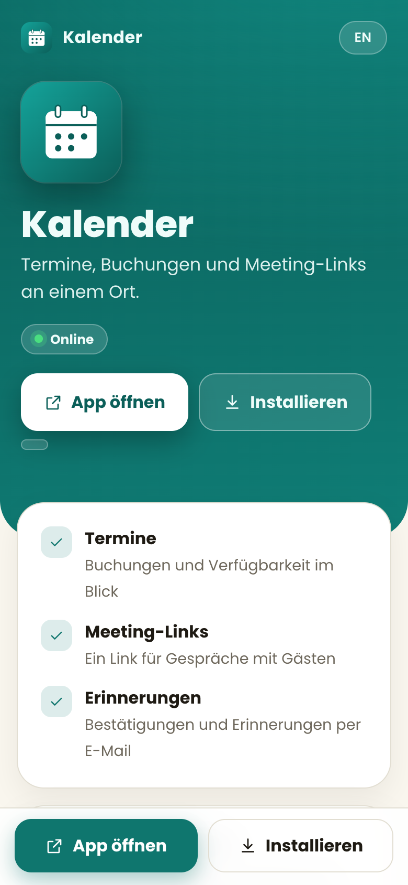
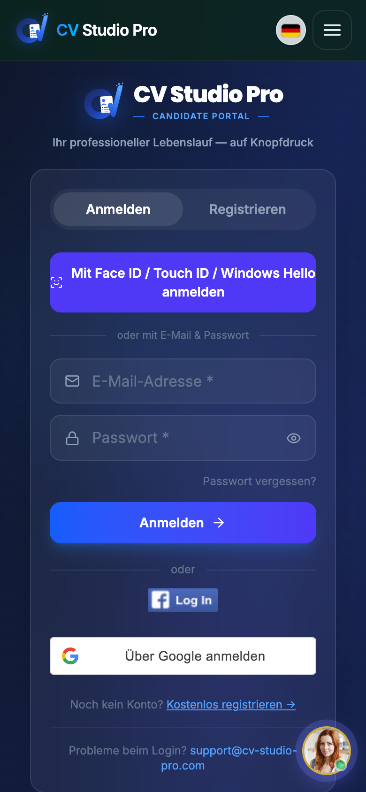
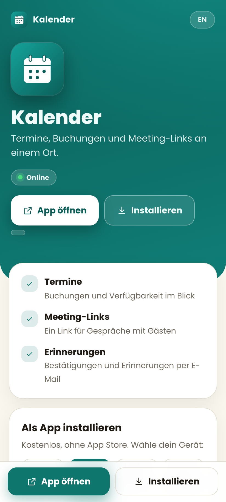
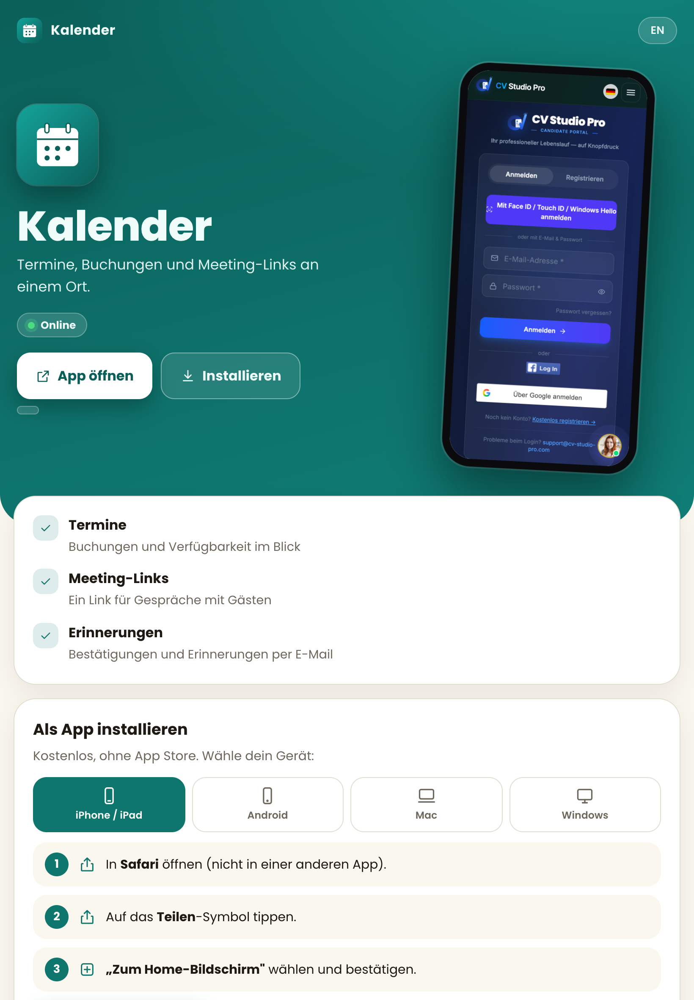
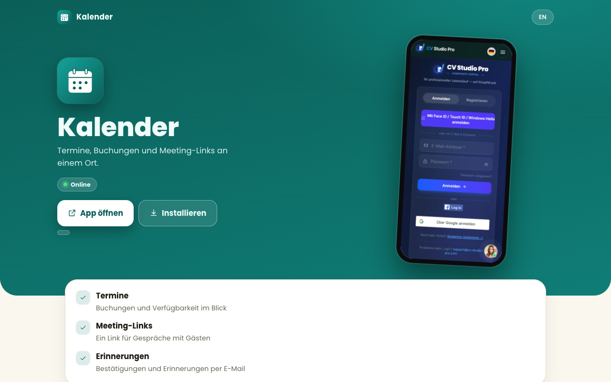

# Kairos

Appointments, bookings and meeting links in one place.

**Open and install: https://romal10.github.io/calendar/**

 

## What you can do

- **Appointments** — Bookings and availability at a glance
- **Meeting links** — One link for calls with guests
- **You approve** — Accept, decline or reschedule requests
- **Appointment details** — Link or address, attendee profile, calendar file

## How it works

1. Create a free account with your name and email (18+, email confirmation) — the same account also works in Rabta.
2. Set when you are available and create meeting links for the kinds of calls you offer.
3. Share your booking link: people choose a slot and send a request; you accept, decline or reschedule it from the calendar or the email.
4. Every appointment has a detail page with the join link or address, the attendee's profile and a calendar file.

## Install the app — free, no app store

Open **https://romal10.github.io/calendar/** on the device you want to install on and follow the steps for that device.

| Device | Steps |
|---|---|
| **iPhone / iPad** | 1. Open the page in **Safari**. 2. Tap the **Share** icon. 3. Choose **Add to Home Screen** and confirm. |
| **Android** | 1. Open the page in **Chrome**. 2. Tap **Install** (or menu ⋮ → **Install app**). |
| **Mac** | Chrome or Edge: click **Install**. Safari: **Share → Add to Dock**. |
| **Windows** | Edge or Chrome: click **Install**, or the install icon in the address bar. |

The app then opens in its own window or from your home screen, like any other app. You can also simply use it in the browser.

### What the page looks like on each device

| iPhone | Android | iPad | Mac / Windows |
|---|---|---|---|
|  |  |  |  |

*(Screenshots show this page at phone, tablet and desktop sizes.)*

## Accounts

- Joining a shared link needs no account where the host allows guests.
- Creating things (links, bookings, listings) and using other apps needs a free account — register inside the app.
- Registered users get every feature after signing in; without an account only this one app is available.

## Good to know

- The service runs privately and is reachable while the host computer is online. If the page shows **Offline**, try again later.
- This repository holds only the static launcher page. The application's code and data are not published here.
